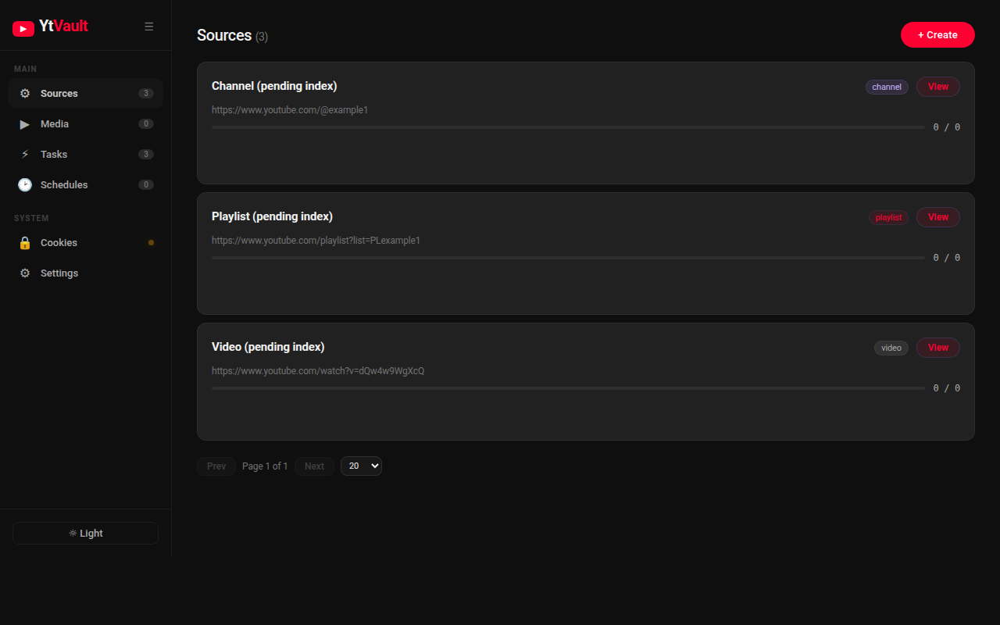
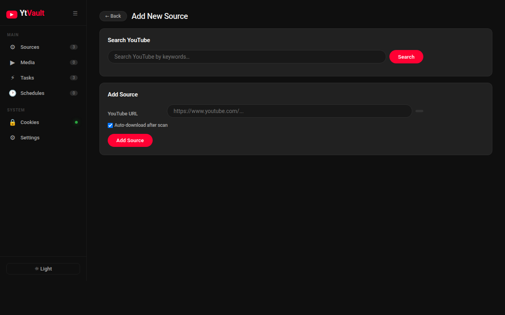
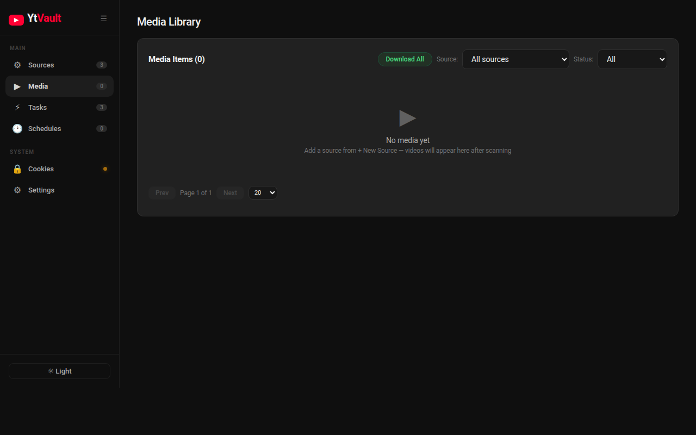
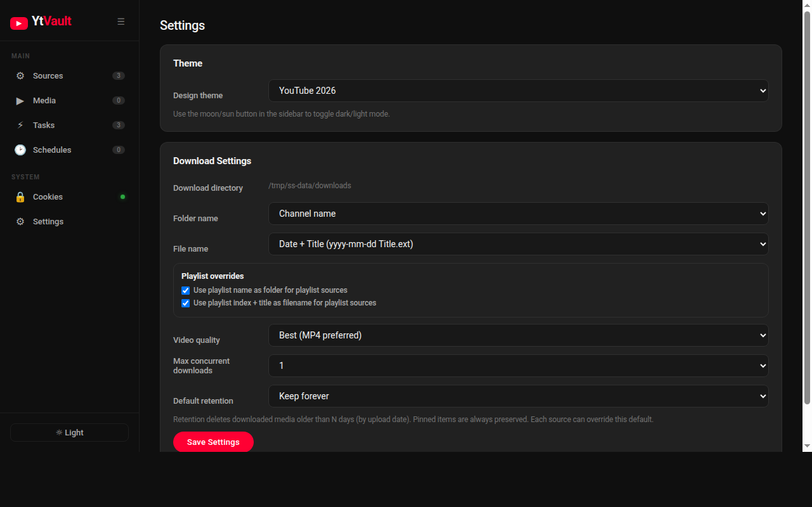

# YtVault

Self-hosted YouTube archive system. Add channels, playlists, or individual videos — YtVault indexes them, schedules recurring scans, and downloads everything to your own storage.

## Screenshots

| Sources | Add New Source |
|---------|---------------|
|  |  |

| Media Library | Settings |
|---------------|----------|
|  |  |

## Features

- **Sources** — add YouTube channels, playlists, or single videos by URL
- **Indexing** — scans a source with `yt-dlp` and stores all video metadata
- **Downloading** — downloads video+audio merged to MP4 via `ffmpeg`
- **Scheduler** — set per-source intervals (1h–1 week); auto-download newly found videos
- **Media management** — pin videos, per-source retention policies, auto-cleanup
- **YouTube search** — search YouTube directly from the app to discover content
- **Themes** — YouTube 2026 (dark/light) and Classic Obsidian Glass (dark/light)
- **Web UI** — sidebar navigation, video thumbnails, responsive design
- **REST API** — full HTTP API for scripting and automation
- **Persistent storage** — JSON state file + download directory; survives restarts

---

## Quick Start (Docker Hub)

**Prerequisites:** Docker and Docker Compose.

```bash
mkdir ytvault && cd ytvault
curl -O https://raw.githubusercontent.com/AC13139/ytvault/main/docker-compose.prod.yml
docker compose -f docker-compose.prod.yml up -d
```

Open **http://localhost:8080** in your browser. To pin a specific version:

```bash
YTVAULT_VERSION=1.0.0 docker compose -f docker-compose.prod.yml up -d
```

### Build from Source

```bash
git clone https://github.com/AC13139/ytvault.git
cd ytvault
docker compose up --build -d
```

Open **http://localhost:8080** in your browser.

Data (state file + downloaded videos) is stored in `./data/` on the host and persists across restarts and container rebuilds.

**Custom port or other overrides:** Create a `docker-compose.override.yml` (gitignored) to override settings without conflicting with `git pull`:

```yaml
services:
  api:
    ports:
      - "8099:8080"
```

### Troubleshooting: Docker Hub timeout on macOS

If the build fails with `DeadlineExceeded` or `context deadline exceeded` when pulling base images, Docker Desktop cannot reach Docker Hub. Fix:

1. Open **Docker Desktop → Settings → Docker Engine** and add:
   ```json
   {
     "dns": ["8.8.8.8", "1.1.1.1"],
     "registry-mirrors": ["https://mirror.gcr.io"]
   }
   ```
2. Click **Apply & Restart**, then re-run `docker compose up --build -d`.

If you are on a VPN, try disabling it for the initial build.

### YouTube cookies (required)

YouTube blocks automated downloads with bot detection. You must provide a cookies file exported from a browser where you are logged into YouTube.

1. Install a browser extension to export cookies in **Netscape format** (e.g. [Get cookies.txt LOCALLY](https://chromewebstore.google.com/detail/get-cookiestxt-locally/cclelndahbckbenkjhflpdbgdldlbecc) for Chrome).
2. Go to youtube.com (make sure you are logged in), export cookies, and save as `data/cookies.txt` (inside the data directory).
3. Restart the container:
   ```bash
   docker compose restart
   ```

The `./data` directory is already mounted into the container. The app reads `YTVAULT_COOKIES_PATH` (default `/data/cookies.txt`) and passes `--cookies` to yt-dlp. If the file does not exist or is a directory, yt-dlp runs without cookies and may fail.

---

## Running Locally (without Docker)

**Prerequisites:** Go 1.26+, `yt-dlp`, and `ffmpeg` on your PATH.

Install yt-dlp and ffmpeg:
```bash
pip install yt-dlp          # or: brew install yt-dlp
brew install ffmpeg         # or: apt install ffmpeg
```

Run the API server:
```bash
go run ./apps/api
```

The server starts on **:8080** by default. Open http://localhost:8080.

---

## Configuration

All settings are environment variables:

**API server:**

| Variable | Default | Description |
|---|---|---|
| `YTVAULT_ADDR` | `:8080` | Listen address |
| `YTVAULT_DATA_PATH` | `./data/state.json` | State file path |
| `YTVAULT_DOWNLOAD_PATH` | `./data/downloads` | Download directory |
| `YTVAULT_COOKIES_PATH` | _(empty)_ | Path to Netscape-format cookies file for yt-dlp |

**CLI:**

| Variable | Default | Description |
|---|---|---|
| `YTVAULT_API` | `http://127.0.0.1:8080` | API base URL |

Example:
```bash
YTVAULT_ADDR=:9000 YTVAULT_DOWNLOAD_PATH=/mnt/media go run ./apps/api
```

---

## Web UI Guide

### Sources tab

The home tab. Add a new source and manage existing ones.

**Adding a source:**
1. Choose **Kind**: Video, Playlist, or Channel
2. Paste the YouTube URL
3. Click **Add Source** — a queued index task is created automatically

**Source actions (per row):**
- **View media** — switches to the Media tab filtered to that source
- **Download all** — creates download tasks for all indexed-but-not-downloaded videos
- **Re-index** — triggers a fresh scan of the source (picks up new videos)

**Setting a schedule:**
Each source row has an inline schedule form:
1. Choose an interval (Every 1h / 6h / 12h / 24h / 1 week)
2. Optionally tick **Auto-dl** — newly found videos are downloaded automatically after each index
3. Click **Set** to save; the schedule activates immediately
4. Click **Remove** → **Confirm?** to delete the schedule (two-click, no popup)

### Media tab

Lists all indexed videos. Use the **Filter** dropdown to narrow by source.

Statuses:
- `pending` — indexed but not downloaded
- `downloading` — download in progress
- `done` — downloaded; file path shown
- `failed` — download failed; check the task error in the Tasks tab

> **Note:** Failed downloads cannot currently be retried through the UI or API. This is a known limitation.

### Tasks tab

Shows all index and download tasks. Click **Start** on any `queued` task to run it immediately. The scheduler starts tasks automatically — manual start is for one-off runs.

Task statuses: `queued` → `running` → `succeeded` / `failed`

### Schedules tab

Overview of all active schedules across sources. Shows last and next run times, enabled state, and auto-download flag. Use the Sources tab to edit or remove individual schedules.

---

## CLI Usage

The `yd` CLI connects to a running YtVault API server.

```bash
# Build the CLI
make build          # produces bin/yd

# Or run directly
go run ./apps/cli <command>
```

Set `YTVAULT_API` if the server is not on localhost:8080:
```bash
export YTVAULT_API=http://my-server:8080
```

**Commands:**

```bash
yd health                                # check server health
yd source list                           # list all sources
yd source add video    <url>             # add a video source
yd source add playlist <url>             # add a playlist source
yd source add channel  <url>             # add a channel source
yd task list                             # list all tasks
yd task run <task_id>                    # stub-complete a queued task
```

---

## API Reference

### Sources

| Method | Path | Description |
|---|---|---|
| `GET` | `/api/v1/sources` | List all sources |
| `POST` | `/api/v1/sources` | Add a source |
| `GET` | `/api/v1/sources/{id}/media` | List media items for a source |
| `POST` | `/api/v1/sources/{id}/reindex` | Start a new index task |
| `POST` | `/api/v1/sources/{id}/download-all` | Create and start download tasks for all pending media |

**Add source request:**
```json
{ "kind": "channel", "url": "https://www.youtube.com/@ChannelHandle" }
```
Supported kinds: `video`, `playlist`, `channel`

### Schedules

| Method | Path | Description |
|---|---|---|
| `GET` | `/api/v1/schedules` | List all schedules |
| `GET` | `/api/v1/sources/{id}/schedule` | Get schedule for a source |
| `POST` | `/api/v1/sources/{id}/schedule` | Create or update a schedule |
| `DELETE` | `/api/v1/sources/{id}/schedule` | Remove a schedule |

**Set schedule request:**
```json
{ "intervalHours": 24, "enabled": true, "autoDownload": true }
```

### Tasks

| Method | Path | Description |
|---|---|---|
| `GET` | `/api/v1/tasks` | List all tasks |
| `POST` | `/api/v1/tasks/{id}/start` | Start a queued task (async, via worker) |
| `POST` | `/api/v1/tasks/{id}/run` | Stub-complete a task synchronously (legacy) |
| `POST` | `/api/v1/tasks/{id}/execute` | Execute with mode: `stub` (succeed) or `fail_stub` (fail) |

### Health

```
GET /healthz   →  { "status": "ok", "service": "ytvault-api", "timestamp": "..." }
```

---

## Makefile Targets

```bash
make run-api       # run API server locally
make test          # run all tests
make build         # build binaries to bin/
make docker-up     # docker compose up --build -d
make docker-down   # docker compose down
make docker-logs   # follow container logs
make docker-build  # build Docker image only
```

---

## Project Structure

```
apps/
  api/        HTTP server entry point
  cli/        CLI client
internal/
  api/        HTTP handlers and Web UI
  models/     shared data types
  scheduler/  background schedule runner
  store/      JSON state persistence
  worker/     async task executor
  yt/         YouTube URL normalisation
  ytdlp/      yt-dlp and ffmpeg wrappers
```

---

## Supported YouTube URL Formats

| Kind | Example URLs |
|---|---|
| Channel | `https://www.youtube.com/@Handle` |
| Channel | `https://www.youtube.com/channel/UCxxxxxx` |
| Playlist | `https://www.youtube.com/playlist?list=PLxxxxxx` |
| Video | `https://www.youtube.com/watch?v=xxxxxxx` |
| Video | `https://youtu.be/xxxxxxx` |
